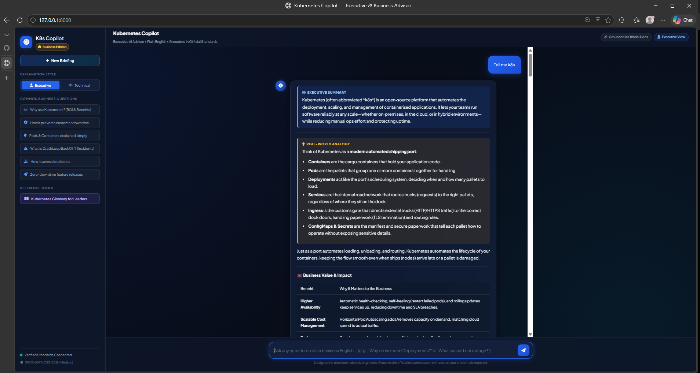

<div align="center">

# ☸ Kubernetes Copilot

**Agentic RAG AI Chatbot — Grounded in Official Kubernetes Documentation**

[](https://python.org)
[](https://fastapi.tiangolo.com)
[](https://langchain-ai.github.io/langgraph/)
[](https://www.trychroma.com)
[](https://groq.com)
[](https://docker.com)

<br />
<br />



</div>

---

## 🌟 What Is This?

**Kubernetes Copilot** is an autonomous AI assistant that answers Kubernetes questions using only **official documentation** as its source of truth. It uses a **LangGraph agent** to intelligently route queries through RAG (ChromaDB), an MCP knowledge registry, or both — then synthesizes grounded answers via **Groq's GPT-OSS 120B** LLM.

**No Kubernetes cluster required.** Works completely standalone.

### Key Capabilities

| Feature | Description |
|---------|-------------|
| 🧠 **Agentic Routing** | LangGraph autonomously picks `rag`, `mcp`, `rag+mcp`, or `direct` per query |
| ⚡ **Groq LPU Inference** | `openai/gpt-oss-120b` with configurable reasoning effort (`low`/`medium`/`high`) |
| 📚 **Grounded Answers** | Every response cites official `kubernetes.io/docs/` sources |
| 💬 **Multi-Turn Memory** | Tracks conversation context across follow-up questions |
| 👍 **Feedback System** | Thumbs up/down with categorical reasons |
| 🎨 **Modern UI** | Dark glassmorphism interface with animations and code highlighting |
| 🐳 **Docker Ready** | One-command deployment with Docker Compose |

---

## 🏗️ Architecture

```
User Browser (HTML/CSS/JS)
         │
         ▼
┌─────────────────────────┐
│     FastAPI Backend      │ ← REST API + Static File Serving
│   /api/chat  /api/health │
└────────────┬────────────┘
             │
             ▼
┌─────────────────────────┐
│     LangGraph Agent      │ ← StateGraph Orchestration
│   Intent → Route → Gen   │
└────────────┬────────────┘
             │
     ┌───────┼───────┐
     ▼       ▼       ▼
   RAG      MCP    RAG+MCP
     │       │       │
     ▼       ▼       ▼
 ChromaDB  K8s Doc  Combined
     │     Registry    │
     └───────┬─────────┘
             ▼
    Groq (gpt-oss-120b)
      Reasoning: Medium
             │
             ▼
    Answer + Source Citations
```

### Agent Decision Flow

```
User Query → understand_query_node()
                    │
        ┌───────────┼───────────────┐
        │           │               │
  "k8s_concept"  "doc_retrieval"  "troubleshooting"
        │           │               │
    rag_node    mcp_node    rag_plus_mcp_node
        │           │               │
        └───────────┼───────────────┘
                    │
          generate_answer_node()
                    │
                   END
```

---

## 📁 Project Structure

```
kubernetes-copilot/
│
├── backend/                    # Python FastAPI Backend
│   ├── main.py                 # FastAPI app, REST endpoints, static mount
│   ├── config.py               # Pydantic Settings (env vars)
│   │
│   ├── agent/                  # LangGraph Agent Layer
│   │   ├── graph.py            # StateGraph: nodes, edges, routing
│   │   ├── state.py            # AgentState TypedDict definition
│   │   └── prompts.py          # System prompts & grounding rules
│   │
│   ├── llm/                    # LLM Provider Layer
│   │   └── grok.py             # UnifiedLLMService: Groq → Grok → Fallback
│   │
│   ├── rag/                    # RAG Pipeline
│   │   ├── chroma.py           # ChromaManager: PersistentClient wrapper
│   │   ├── embeddings.py       # SentenceTransformers embedding service
│   │   └── retriever.py        # KubernetesRetriever: search + format
│   │
│   └── mcp/                    # Model Context Protocol
│       └── client.py           # K8S_DOCS_REGISTRY + search/lookup
│
├── frontend/                   # Client-Side UI
│   ├── index.html              # Chat interface (semantic HTML5)
│   ├── style.css               # Dark glassmorphism design system
│   └── script.js               # Chat logic, markdown, feedback
│
├── ingestion/                  # Knowledge Base Population
│   ├── ingest.py               # CLI entry point (--reset flag)
│   ├── loader.py               # KubernetesDocLoader (registry + URL)
│   └── chunker.py              # KubernetesChunker (550 chars, 80 overlap)
│
├── deploy/                     # AWS EC2 Deployment Scripts
│   ├── setup_ec2.sh            # One-time EC2 setup (Docker install)
│   └── deploy.sh               # Build + start containers
│
├── .env                        # API keys & config (git-ignored)
├── .env.example                # Template for .env
├── .gitignore                  # Git exclusions
├── .dockerignore               # Docker build exclusions
├── Dockerfile                  # Container image definition
├── docker-compose.yml          # Multi-service orchestration
├── nginx.conf                  # Reverse proxy config
├── requirements.txt            # Python dependencies
└── README.md                   # ← You are here
```

---

## ⚡ Quick Start

### Prerequisites

- **Python 3.11+**
- **Groq API Key** — Get one free at [console.groq.com](https://console.groq.com/)

### 1. Clone & Setup

```bash
git clone https://github.com/YOUR_USERNAME/kubernetes-copilot.git
cd kubernetes-copilot

# Create virtual environment
python -m venv .venv

# Activate
# Linux/Mac:
source .venv/bin/activate
# Windows:
.venv\Scripts\activate

# Install dependencies
pip install -r requirements.txt
```

### 2. Configure Environment

```bash
cp .env.example .env
```

Edit `.env` and set your API key:

```ini
LLM_PROVIDER=groq
GROQ_API_KEY=gsk_your_actual_key_here
GROQ_MODEL=openai/gpt-oss-120b
GROQ_REASONING_EFFORT=medium
```

### 3. Ingest Knowledge Base

```bash
# First time — populates ChromaDB with official K8s docs
python -m ingestion.ingest

# Reset and re-ingest
python -m ingestion.ingest --reset
```

> **Note:** The server auto-ingests on first startup if ChromaDB is empty. This step is optional.

### 4. Run the Server

```bash
uvicorn backend.main:app --host 127.0.0.1 --port 8000 --reload
```

Open → **http://127.0.0.1:8000**

---

## 🐳 Docker Deployment

### Local Docker

```bash
# Build and start (app + nginx)
docker-compose up -d

# View logs
docker-compose logs -f

# Stop
docker-compose down
```

App: `http://localhost:80` (via Nginx) or `http://localhost:8000` (direct)

### AWS EC2

```bash
# 1. SSH into EC2 (Ubuntu 22.04, t3.medium)
ssh -i key.pem ubuntu@<EC2_IP>

# 2. Run setup script (installs Docker)
bash deploy/setup_ec2.sh

# 3. Upload project files via SCP or git clone

# 4. Create .env with your API keys

# 5. Deploy
docker-compose up -d
```

See `deploy/setup_ec2.sh` and `deploy/deploy.sh` for full automation.

---

## 📡 API Reference

### Health Check

```http
GET /api/health
```

```json
{
  "status": "healthy",
  "service": "Kubernetes Copilot",
  "version": "1.0.0",
  "docs_count": 380,
  "llm_provider": "groq",
  "llm_configured": true,
  "llm_model": "openai/gpt-oss-120b",
  "reasoning_effort": "medium"
}
```

### Create Conversation

```http
POST /api/conversations
```

```json
{
  "conversation_id": "conv-a1b2c3d4e5f6",
  "created_at": "2026-10-05T06:30:00.000Z"
}
```

### Chat

```http
POST /api/chat
Content-Type: application/json

{
  "message": "What is a Kubernetes Pod?",
  "conversation_id": "conv-a1b2c3d4e5f6"
}
```

**Response:**

```json
{
  "answer": "## 📌 Executive Summary\nA Pod is the smallest deployable unit...",
  "sources": [
    {
      "title": "Pods",
      "url": "https://kubernetes.io/docs/concepts/workloads/pods/",
      "section": "Concepts > Workloads > Pods"
    }
  ],
  "tools_used": ["rag"],
  "conversation_id": "conv-a1b2c3d4e5f6",
  "timestamp": "2026-10-05T06:34:16.892Z"
}
```

### Get Conversation History

```http
GET /api/conversations/{conversation_id}
```

### Submit Feedback

```http
POST /api/feedback
Content-Type: application/json

{
  "conversation_id": "conv-a1b2c3d4e5f6",
  "thumb": "up",
  "message_index": 0,
  "reason": "accurate",
  "comment": "Great explanation!"
}
```

---

## ⚙️ Configuration Reference

All settings are defined in `.env` and loaded via [`backend/config.py`](backend/config.py).

| Variable | Default | Description |
|----------|---------|-------------|
| `LLM_PROVIDER` | `groq` | Active LLM: `groq` or `grok` |
| `GROQ_API_KEY` | — | Groq API key (starts with `gsk_`) |
| `GROQ_BASE_URL` | `https://api.groq.com` | Groq API endpoint |
| `GROQ_MODEL` | `openai/gpt-oss-120b` | Groq model identifier |
| `GROQ_REASONING_EFFORT` | `medium` | Reasoning depth: `low`, `medium`, `high` |
| `GROK_API_KEY` | — | xAI Grok API key (optional) |
| `GROK_BASE_URL` | `https://api.x.ai/v1` | Grok API endpoint |
| `GROK_MODEL` | `grok-2-latest` | Grok model identifier |
| `CHROMA_PERSIST_DIRECTORY` | `./chroma_db` | ChromaDB storage path |
| `COLLECTION_NAME` | `k8s_docs` | ChromaDB collection name |
| `EMBEDDING_MODEL_NAME` | `sentence-transformers/all-MiniLM-L6-v2` | Embedding model |
| `HOST` | `127.0.0.1` | Server bind address |
| `PORT` | `8000` | Server port |
| `DEBUG` | `True` | Debug mode |

---

## 🧩 How the Agent Works

### LangGraph StateGraph Pipeline

The agent is defined in [`backend/agent/graph.py`](backend/agent/graph.py) as a compiled LangGraph `StateGraph`:

```
Entry → understand_query → [conditional routing] → retrieval node → generate_answer → END
```

**Nodes:**

| Node | Function | Purpose |
|------|----------|---------|
| `understand_query` | `understand_query_node()` | Classifies intent, selects tool |
| `rag_node` | `rag_node()` | Semantic search via ChromaDB |
| `mcp_node` | `mcp_node()` | Keyword search in K8S_DOCS_REGISTRY |
| `rag_plus_mcp_node` | `rag_plus_mcp_node()` | Both RAG + MCP combined |
| `generate_answer` | `generate_answer_node()` | LLM synthesis with grounding |

**Routing Logic:**

| Intent | Tool Selected | When |
|--------|---------------|------|
| `k8s_concept` | `rag` | "What is a Pod?", "Explain Services" |
| `doc_retrieval` | `mcp` | "Find official docs for Ingress" |
| `troubleshooting` | `rag+mcp` | "CrashLoopBackOff fix", "OOMKilled debug" |
| `greeting` | `direct` | "Hello", "Hi" |

### LLM Provider Cascade

Defined in [`backend/llm/grok.py`](backend/llm/grok.py) — `UnifiedLLMService`:

```
1. Groq (ChatGroq with gpt-oss-120b + reasoning_effort)
   ↓ if unavailable
2. Grok (ChatOpenAI with xAI endpoint)
   ↓ if unavailable
3. Local Grounded Fallback (context extraction, no API needed)
```

### RAG Pipeline

| Step | Module | Description |
|------|--------|-------------|
| Embed | `backend/rag/embeddings.py` | `all-MiniLM-L6-v2` (384-dim vectors) |
| Store | `backend/rag/chroma.py` | ChromaDB `PersistentClient` |
| Search | `backend/rag/retriever.py` | Top-k semantic search + context formatting |

### MCP Client

Defined in [`backend/mcp/client.py`](backend/mcp/client.py):

- `K8S_DOCS_REGISTRY` — curated list of official K8s doc entries with `title`, `section`, `url`, `keywords`, `content`
- `search_docs()` — weighted keyword matching (title=5, keywords=3, content=1)
- `get_doc_by_id()` / `get_doc_by_url()` — direct lookups

### Ingestion Pipeline

Defined in `ingestion/`:

```
K8S_DOCS_REGISTRY → KubernetesDocLoader → KubernetesChunker (550 chars, 80 overlap) → Embeddings → ChromaDB
```

Run: `python -m ingestion.ingest --reset`

---

## 🛡️ Grounding & Safety

1. **Strict Context Alignment** — answers are synthesized only from retrieved documentation
2. **No Command Hallucination** — only verified `kubectl` flags and manifest fields
3. **Graceful Fallback** — if docs insufficient: *"I couldn't find sufficient information..."*
4. **No Cluster Access** — zero cluster dependencies, safe for air-gapped environments
5. **Source Citations** — every answer includes clickable `kubernetes.io/docs/` links

---

## 🔧 Development

### Running Tests

```bash
# Health check
curl http://localhost:8000/api/health

# Test chat
curl -X POST http://localhost:8000/api/chat \
  -H "Content-Type: application/json" \
  -d '{"message": "What is a Pod?"}'

# Check ChromaDB document count
python -c "from backend.rag.chroma import chroma_manager; print(chroma_manager.count())"
```

### Adding New Documentation

1. Add entries to `K8S_DOCS_REGISTRY` in [`backend/mcp/client.py`](backend/mcp/client.py)
2. Re-ingest: `python -m ingestion.ingest --reset`

### Switching LLM Provider

```ini
# In .env — switch to Grok:
LLM_PROVIDER=grok
GROK_API_KEY=your-xai-key
```

### Docker Operations

```bash
docker-compose logs -f                          # Stream logs
docker-compose restart kubernetes-copilot       # Restart app
docker-compose build --no-cache                 # Rebuild image
docker exec kubernetes-copilot python -m ingestion.ingest --reset  # Re-ingest in container
```

---

## 🗺️ Tech Stack

| Layer | Technology | Purpose |
|-------|-----------|---------|
| **Frontend** | HTML5, CSS3, JavaScript | Chat UI with glassmorphism design |
| **Backend** | Python, FastAPI, Uvicorn | REST API server |
| **Agent** | LangGraph (StateGraph) | Autonomous tool routing |
| **RAG** | LangChain, ChromaDB | Semantic document retrieval |
| **Embeddings** | SentenceTransformers (`all-MiniLM-L6-v2`) | 384-dim vector generation |
| **LLM** | Groq (`gpt-oss-120b`) / xAI Grok | Answer synthesis |
| **MCP** | Custom K8S_DOCS_REGISTRY | Official doc keyword search |
| **Config** | Pydantic Settings, python-dotenv | Environment management |
| **Deploy** | Docker, Docker Compose, Nginx | Containerized production deployment |

---

## 📄 License

MIT License — see [LICENSE](LICENSE) for details.

---

<div align="center">

**Built with ❤️ for DevOps, SREs, and Kubernetes learners.**

</div>
